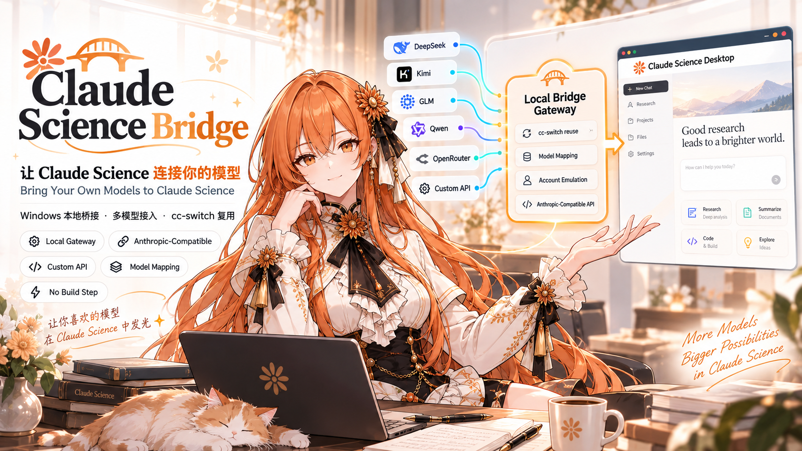

<p align="center"></p>

<h1 align="center">Claude Science Bridge</h1>

<p align="center"><strong>Bring your own models to Claude Science</strong><br />
Bridge the Claude Science desktop app on Windows to your own model API — no build step.</p>

<p align="center"><strong>English</strong> · <a href="README.zh-CN.md">简体中文</a></p>

<p align="center">
  <a href="https://github.com/lizilong1993/claude-science-bridge/releases/latest"></a>
  
  
  <a href="LICENSE"></a>
</p>

## What is this

Claude Science Bridge connects the **Claude Science desktop app on Windows** to a model API **you** own.

It runs a local gateway, writes a virtual login profile for Science, and launches the app with
`ANTHROPIC_BASE_URL` pointing at that gateway. It also serves a small set of emulated account APIs so the UI
does not insist on a Claude account. **Your Claude Science installation is never modified.**

| | |
| --- | --- |
| **Use your own models** | Map Science's model roles to upstream models from DeepSeek, Kimi, GLM, Qwen, SiliconFlow, OpenRouter, or any Anthropic / OpenAI-compatible endpoint. |
| **Reuse cc-switch** (recommended) | Use the first provider in your Claude Desktop list, or pick any other by name. |
| **Or skip cc-switch** | Configure an endpoint directly with built-in presets or a custom `baseUrl`. |
| **One-time setup** | `install.cmd` points the Start Menu shortcut at the bridge, then every normal launch just works. |
| **No build step** | Plain Node.js scripts, **zero npm dependencies**, no Rust / VS / Tauri toolchain. |

> An independent community tool. It does not include Claude Science, API keys, subscriptions, or model quota,
> and it is not affiliated with Anthropic.

## How to use

### Requirements

| Item | Requirement |
| --- | --- |
| OS | Windows 10/11 x64. No administrator rights needed. |
| Node.js | **≥ 22.5** (uses built-in `node:sqlite`; tested **24.18**). |
| OpenSSL | Needed for account emulation. **Bundled with Git for Windows.** |
| Claude Science | Windows desktop version (tested **0.1.63**). |
| cc-switch | Optional. Only for Method A. |

Download the ZIP from [Releases](https://github.com/lizilong1993/claude-science-bridge/releases/latest)
and unzip it anywhere, for example `D:\claude-science-bridge`.

### Method A — reuse cc-switch (recommended)

1. In cc-switch, configure a **Claude Desktop** provider: endpoint, API key, and model mapping.
2. In the unzipped folder, run **`list-providers.cmd`** to list the available providers and their model mapping.
3. Double-click **`install.cmd`** — **only once**. It points the Start Menu shortcut "Claude Science" at this bridge
   (the original shortcut is backed up; `uninstall.cmd` restores it).
4. From now on, just start **Claude Science** from the Start Menu. The bridge starts automatically every time.
5. In Science, pick a model in the model selector and send a message.

By default the bridge uses the **first** provider in your Claude Desktop list. To pin another one, edit `config.json`:

```json
{
  "source": "ccswitch",
  "ccswitch": { "app": "claude-desktop", "provider": "OpenDesign", "transport": "direct" }
}
```

- `provider`: `first` (default) · `current` · a provider **name** · a provider **id**.
- `transport`: `direct` (default — reads endpoint and key straight from the cc-switch database, so **cc-switch does not need to stay running**)
  or `proxy` (goes through the cc-switch gateway, which must be running).

### Method B — without cc-switch

```json
{
  "source": "custom",
  "custom": { "preset": "deepseek", "type": "anthropic", "apiKey": "YOUR_API_KEY", "model": "deepseek-chat" }
}
```

Presets: `deepseek`, `kimi`, `kimi-global`, `glm`, `glm-intl`, `qwen`, `siliconflow`, `openrouter`, `doubao`, `ppio`, `mimo`, `longcat`, `groq`, `mistral`.
For anything else, set `custom.baseUrl` and `custom.type` (`anthropic` or `openai`) directly.
To map each model role separately, use `custom.models` instead of `custom.model` — see `config.example.json`.

### Stop and restore

| Action | How |
| --- | --- |
| Stop the bridge | Just exit Claude Science — the gateway and local proxy stop automatically. Or run `stop.cmd` to stop everything at once. |
| Restore the Start Menu shortcut | `uninstall.cmd` |
| Trust / untrust the local CA | `trust-ca.cmd` / `untrust-ca.cmd` (also done by `install.cmd` / `uninstall.cmd`) |
| Start manually (troubleshooting) | `start.cmd` |
| Go back to a real Claude account | Stop the bridge, delete `.oauth-tokens/` and `active-org.json` under `%USERPROFILE%\.claude-science`, then start Science normally |

### config.json quick reference

| Field | Meaning |
| --- | --- |
| `source` | `ccswitch` or `custom` |
| `ccswitch.provider` | `first` \| `current` \| name \| id |
| `ccswitch.transport` | `direct` (recommended) or `proxy` |
| `account.name` | Virtual account name shown in Science (default `admin`) |
| `custom.preset` / `baseUrl` / `type` / `apiKey` | Custom upstream endpoint |
| `custom.model` / `models` | One upstream model for all roles, or a per-role mapping |
| `lifecycle.stopWithApp` | `true` (default): stopping Claude Science also stops the gateway and local proxy |
| `gateway.port` / `accountEmulation.*` | Local ports; usually leave as is |
| `science.exePath` / `dataDir` | Leave empty for the default install and `%USERPROFILE%\.claude-science` |

Full annotated defaults: [`config.example.json`](config.example.json).

### Notes and limits

- **Account emulation is on by default.** It answers a few `claude.ai` endpoints locally so the account banner and
  account panels behave as if signed in. This requires Claude Science to trust this tool's local CA — the app's
  native TLS stack reads the Windows certificate store, so `install.cmd` adds the CA to **your user** root store
  (per-user, no admin). `uninstall.cmd` removes it; `trust-ca.cmd` / `untrust-ca.cmd` do it manually.
- To turn the emulation off, set `accountEmulation.enabled` to `false` in `config.json`. Chat, MCP connectors and
  local skills work either way; only the account banner and account panels are affected.
- Directory connectors (Anthropic-hosted directory) appear empty — that is the true state of a virtual account.
  The bundled connectors under **Featured** do work.
- Tested against Claude Science **0.1.63**. A future client update may change these interfaces.
- Keep `config.json` private: it may contain your API key. It is git-ignored by default.

## Credits and notices

- **[cc-switch](https://github.com/farion1231/cc-switch)** by farion1231 — this bridge reuses provider definitions
  (endpoint, credentials, role-to-model mapping) from its local database, and several built-in presets are derived
  from its published Claude Desktop preset catalogue. Thank you.
- **[CSSwitch](https://github.com/SuperJJ007/CSSwitch)** by SuperJJ007 — the virtual-login approach used here
  (writing a `v2`-encrypted token plus `active-org.json` into Science's data directory, then pointing
  `ANTHROPIC_BASE_URL` at a local gateway) follows the design CSSwitch pioneered and validated on macOS.
  Thanks also to its contributors and to the community work behind its Claude Science pull requests.
- Claude, Claude Science and all provider names are trademarks of their respective owners.
  This project is not affiliated with Anthropic, cc-switch, or CSSwitch.

## License

[MIT](LICENSE)
